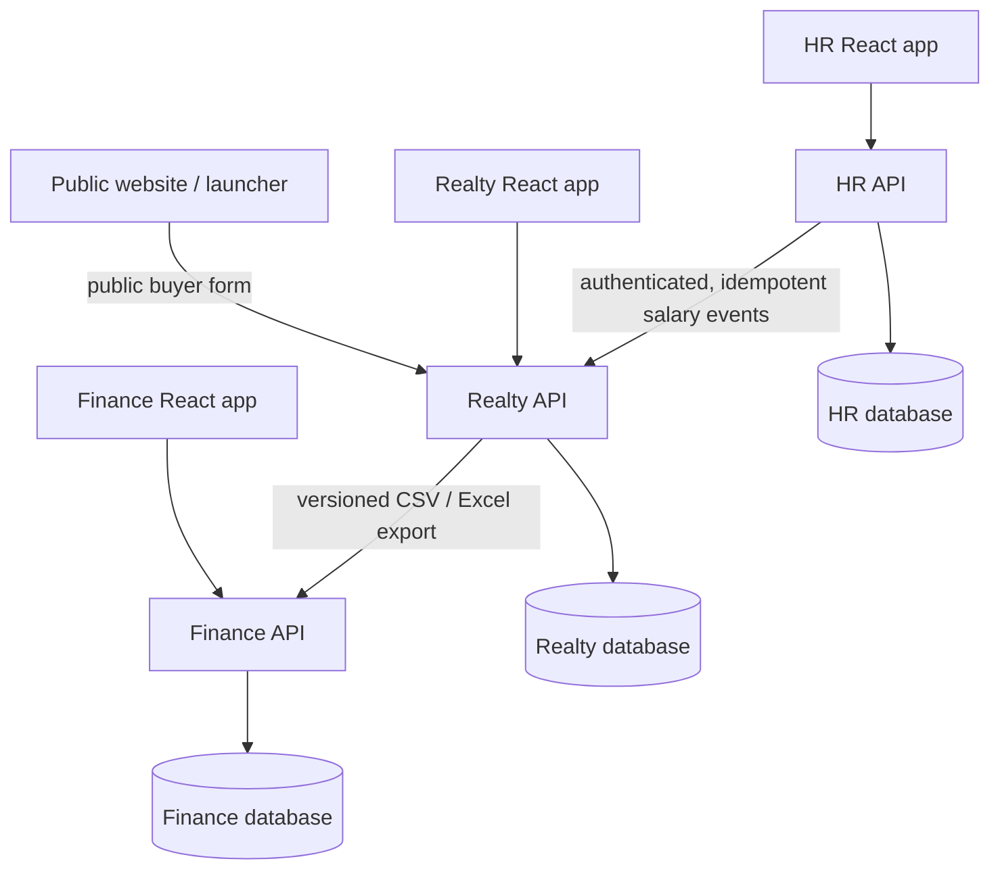

# D&C Prime Realty — Batch 3 System Architecture

**Date:** 27 October 2026  
**Phase:** 1 — Preparation | **Batch:** 3 / 16  
**State:** PROPOSED DESIGN, read-only. Nothing implemented or deployed.  
**Source baseline:** `AllCodes(20261027-060053).txt`; `dc_prime_realty_full_backup_2026_27(1).sql`; Batch 1 and Batch 2 audit artifacts.

## 1. Scope and guardrails

Design independent Real Estate Management, HR & Payroll, and Finance Management applications plus a public website while preserving existing business records, calculation behavior, historical evidence, and production reversibility.

**Not in Batch 3:** executing SQL, creating accounts, restructuring current folders, installing dependencies, changing URLs, moving files, updating credentials, running migrations, or deploying applications.

**Existing findings (from Batch 2, not new live verification):** 105 SQL tables; 17 HR-related tables; 88 other tables stay in Realty initially; 276 declared foreign keys, including 20 HR→`users` and 16 HR→HR; 10 HR configuration columns in shared `system_settings`; Seller Network import and undo touch `employees`; Realty Company Finances reads `employee_payrolls` and `employee_cash_advances`; signed payroll receipts use shared Cloudinary/webhook code.

## 2. Target ownership

| System | App folders | Exclusive data authority | Database | Special boundary |
|---|---|---|---|---|
| Public website | `apps/website` | Public pages, launcher | None | Buyer intake calls the *public Realty API*; no direct DB, no privileged API token in browser |
| Real Estate | `apps/realty-client`, `apps/realty-server` | Listings, buyers, contracts, SOA, reservations, payments, commissions, Seller Network, original Company Finances and received salary projection | **existing** `dc_prime_realty_system_db` (keep current name during migration) | Does not query HR DB |
| HR & Payroll | `apps/hr-client`, `apps/hr-server` | Employees, HR identity, schedules, attendance, payroll, payroll corrections, salary releases, receipts, HR audit, HR settings | **new** `dc_prime_hr_db` | Does not query Realty DB |
| Finance Management | `apps/finance-client`, `apps/finance-server` | Independent manual ledger, categories, income/expense entries, imports, adjustments, reports, Finance identity and audit | **new** `dc_prime_finance_db` | Does not query Realty or HR DB; receives versioned file imports |

One Git repository, independently runnable/deployable apps; separate production secrets, database users, CORS allowlists, cookie host scopes, scheduled jobs, and deployment checks. A common Git repository does **not** imply shared authorization or shared database access. Separate database instances/accounts are preferred when deployment supports them; isolated DBs with separate least-privilege credentials are an intermediate stage.

### Target directory layout (create in Batch 4)

```text
dc-prime-realty/
├── apps/
│   ├── website/
│   ├── realty-client/
│   ├── realty-server/
│   ├── hr-client/
│   ├── hr-server/
│   ├── finance-client/
│   └── finance-server/
├── packages/
│   ├── shared-ui/          # presentation only; add only when genuinely reused
│   └── shared-utils/       # pure formatting, date/amount utilities only
├── docs/
│   ├── architecture/
│   ├── migrations/
│   └── testing/
├── package.json           # npm workspaces, app-specific scripts
└── .gitignore
```

The current `client/` and `server/` remain intact through Batch 3. Batch 4 introduces `apps/` incrementally; old paths may coexist during extraction. **Do not** share controllers, authorization middleware, database pools, secrets, employee details, or domain-specific financial rules through `packages/`. Preserve each backend's own `migrations/`, `tests/` and `config/`. The proposed seven app names are directory recommendations, not evidence that these paths exist.

### Logical interactions



The arrow HR→Realty is an API transfer, **not** a cross-database query. Realty→Finance is a validated export/import workflow, **not** a database link or automatic write-through. The website never handles HR or Finance sessions.

## 3. Explicit architectural decisions

**DEC-01 — Repository:** npm workspaces monorepo. Keep React/Vite and Express/Node; do not introduce a new framework as part of separation. The actual root workspace files and deployment scripts will be created/tested in Batch 4.

**DEC-02 — Data isolation:** one DB connection pool per backend; no cross-DB joins, foreign keys, direct data imports at runtime, or use of another system's credentials. External references are strings or numbers without cross-service FK.

**DEC-03 — Login:** each protected application has independent accounts, password reset, roles, permissions, session secrets and authorization checks. An individual may have accounts in more than one system, but email or a matching numeric ID is not authorization. Plan explicitly for invitation/reset on migration; do not automatically carry over one app's session or copy old password hashes as a shortcut.

**DEC-04 — HR actor migration:** new HR `users` or `hr_users` own permissions; `hr_legacy_user_map` links historical Realty user IDs to HR identities where a match is proven. Each historical HR action retains immutable original actor ID, action timestamp, and available display snapshot; unresolved actors remain traceable without silently assigning an incorrect user.

**DEC-05 — Seller Network split:** Realty owns seller and network users; HR owns employee links. Realty Seller Network Excel import must stop `SELECT/UPDATE employees` and must not create or alter HR employees. Preserve `network_member_import_items.linked_employee_ids_json` for older undo history. A new optional HR-managed mapping can link an employee to a Realty external user reference after separate verification; email matches alone do not authorize linking. See contract 02.

**DEC-06 — Import undo:** do not delete a Realty account still referenced by HR. Before undo of newly created accounts, check an HR-owned *read-only link-eligibility API* for those Realty user IDs (bulk input). If HR is unreachable or reports active links, **block deletion** and show a reconciliation action; do not bypass the check or run a distributed database transaction. Existing Realty checks for sales, commissions, hierarchy and other usage remain. Old snapshots remain readable but don't themselves grant permission to unlink someone from HR.

**DEC-07 — Salary finance projection:** HR alone authorizes release and owns original payroll. On completed cash release, write an HR outbox event in the **same HR DB transaction** as the release. A retryable sender sends a minimal salary cash event to the protected Realty API. Realty records the event idempotently and materializes a local financial entry; existing Realty finance queries use that entry instead of `employee_payrolls`. Do not make finance calculations depend on a live HR API query. Never assume a corrected payslip means cash was refunded; reversal or return entries require an explicit reason and cash-movement semantics. See contract 01.

**DEC-08 — Finance Management:** new independent ledger starts with a zero opening balance by default. Keep the existing Realty tracker in Realty. The independent Finance system does **not** ingest salary directly from HR when Realty exports already include salary; otherwise payroll would be double-counted. Import identities derive from source system + source transaction ID, not the filename.

**DEC-09 — Audit/notification:** keep original Realty audit and archived evidence intact. Copy HR-related audit material and notifications only when their owner and references can be identified; mark cross-service historical references with `source_system` and original IDs. New HR actions write only HR audit. New Finance actions write only Finance audit. For ambiguous mixed records, preserve an immutable source snapshot with an unresolved classification flag rather than deleting records.

**DEC-10 — Protected documents:** HR owns signed payroll receipts after cutover, Realty owns listing/payment documents. Copy/verify metadata and existing protected Cloudinary asset IDs before switching access; don't put raw protected URLs into cross-system event payloads. Verify provider signatures at ingress; route malware-status callbacks to the owning service or relay a signed internal update. Payroll file access requires HR authorization. A shared vendor account does not grant one application access to another's employee data.

**DEC-11 — Jobs:** HR exclusively runs attendance auto-timeout; Realty exclusively runs property penalty refresh. Never run duplicate active schedulers during cutover. The public kiosk and HR-facing attendance routes move to HR; public buyer-form endpoints stay in Realty.

**DEC-12 — Currency and dates:** PHP amounts use `DECIMAL` in storage and decimal *strings with exactly two fractional digits* in JSON/CSV; no floating-point amount comparison. Business dates use `YYYY-MM-DD` in Asia/Manila; event timestamps use timezone-aware RFC 3339/UTC. Sorting/reconciliation retains both effective payment date and event recorded time.

**DEC-13 — Import/export:** preserve existing seven-column report CSV for humans. Add a separately versioned, machine-importable CSV/Excel contract. Import preview, source ID, version, immutable history, correction policies, category mapping, duplicate handling and formula-injection protection are mandatory before the Finance cutover.

**DEC-14 — Rollback:** use expand → copy/backfill → dual-read verification (never independent dual-authoritative write) → freeze/sync → cut over → observe → retire. Once HR receives production writes, restoring the old application alone cannot restore correctness: reverse migration or reconcile all new writes first. No destructive schema change before the final cleanup gate.

## 4. Boundaries and security design

- Proposed separate hosts: `website`, `realty`, `hr`, `finance`, plus their corresponding API hosts. **Hostnames are illustrative**, not verified DNS records or deployment configuration.
- Use HTTPS; cookies set by each API should use host-only scope (`Domain` omitted), `Secure`, `HttpOnly`, suitable `SameSite` and CSRF protection. Where the deployment allows it, use `__Host-` prefixed cookies with `Path=/` and no `Domain` attribute. Configure explicit allowed origins and `credentials` only when required. Never use a shared wildcard cookie domain to simulate single sign-on.
- Independently enforce API permissions: no permission inference from UI links, Realty roles, numeric `user_id`, or matching email.
- Protect service-to-service salary event ingress with short-lived audience-scoped machine credentials, HTTPS, timestamp/replay validation, and source allowlisting. Never expose machine credentials to the browser. Log attempts without payroll personal details.
- Separate database migrations, secrets and backups. Per-service outage must not permit access to another service's records; HR salary transfer delays can be replayed and flagged without fabricating financial entries.

## 5. Project-specific preservation rules

1. Preserve Realty property payments, SOA/reservation allocations, commission releases, archived releases, network payouts, refunds and manually posted finance entries.
2. Preserve existing HR released payroll snapshot and `net_fund_release`, original actor/release date, signed receipt, corrections and audit lineage.
3. Preserve preexisting network import undo rules for current/historical sales and linked users, while preventing Realty from mutating HR after cutover.
4. Keep Realty's zero-baseline consolidated finance behavior; introduce a zero-baseline independent Finance ledger without implicitly merging histories.
5. Retain the original `dc_prime_realty_system_db` name during migration to avoid an unrelated breaking rename.

## 6. Dependency-informed migration ordering

| Batch | Required architectural implementation |
|---|---|
| 4 | Create workspace skeleton, isolated staging config and deployment mapping; keep legacy entry points running |
| 5 | New HR database, 17 HR tables, 10 attendance/department settings, independent users/permissions/audit, identity mapping, outbox schema |
| 6 | Extract HR backend, event sender, protected payroll file routes and attendance scheduler; convert runtime `CREATE/ALTER` behavior to versioned migrations; stop Seller Network from writing employees |
| 7 | Extract HR frontend, kiosk, HR login and role-based access |
| 8 | Realty salary event receiver/projection, finance SQL replacement, cash-advance-warning policy, updated network import undo check |
| 9 | HR rows, user mappings, audit records and receipt backfill; reconcile live/released payroll against Realty salary projection |
| 10 | HR write freeze/final sync/cutover, single active scheduler, block legacy HR writes and verify no direct HR queries in Realty |
| 11 | Machine-readable versioned Realty finance CSV/Excel alongside current report CSV |
| 12 | New independent Finance DB, backend, frontend, ledger and auth |
| 13 | Finance source-ID import validation, correction/reversal handling, audit and report mapping |
| 14 | Finance reconciliation and cutover |
| 15 | Final security/regression/backup restore and dependency verification, obtain permission for planned deletions |
| 16 | Controlled obsolete code/table/column removal and post-cleanup regression |

## 7. Acceptance criteria for Batch 3 design

- [x] Named authoritative owner for each business domain, shared identity/config/audit/document boundary.
- [x] Defined HR→Realty salary transfer with idempotency, compensation, retry and reconciliation.
- [x] Defined Realty→Finance import/export contract and anti-duplication rule.
- [x] Defined Seller Network employee-link migration and blocked-undo behavior.
- [x] Defined proposed seven-app npm workspace layout and separation of deployment/security.
- [x] Defined extraction, data-copy and cutover order without database deletion.
- [ ] Confirm design with system owner and decide any unsettled policy choices in Decision Log.
- [ ] Resolve Batch 1 live restore/complete-checkout validation and Batch 2 live dependency verification **before Batch 4 touches production**.

**Batch 3 outcome:** Architecture document prepared. **Not an implementation or deployment approval.**

## External guidance (background, not source evidence)

- AWS incremental extraction: https://docs.aws.amazon.com/prescriptive-guidance/latest/cloud-design-patterns/strangler-fig.html
- Microsoft event outbox pattern: https://learn.microsoft.com/en-us/dotnet/architecture/microservices/multi-container-microservice-net-applications/subscribe-events
- OWASP scoped sessions: https://cheatsheetseries.owasp.org/cheatsheets/Session_Management_Cheat_Sheet.html
